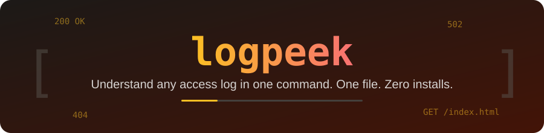

<p align="center">
  
</p>

<p align="center">
  
  
  
</p>

**logpeek** is a single Python file that turns a raw Apache/Nginx access log into a clear summary:
top IPs, top paths, status codes, 404 hunters, user agents and traffic by hour.
No `pip install`, no dependencies. Download one file and run it.

<p align="center">
  
</p>

## Run

```bash
python logpeek.py /var/log/nginx/access.log
```

Or grab just the file:

```bash
curl -O https://raw.githubusercontent.com/ERROR404DTIR/logpeek/main/logpeek.py
```

## Options

| Option | What it does |
|---|---|
| `file` | Log file, `.gz` works too. Reads `stdin` if omitted or `-` |
| `-n, --top N` | Rows per section (default 5) |
| `--status 404` / `5xx` | Only count this status or class |
| `--ip 1.2.3.4` | Only requests from this client |
| `--json` | Machine-readable output |

## Examples

```bash
python logpeek.py access.log --top 10
python logpeek.py access.log.gz --status 5xx
python logpeek.py access.log --ip 203.0.113.7
tail -n 5000 access.log | python logpeek.py
python logpeek.py access.log --json > report.json
```

## Why

- **One file**, readable in a few minutes
- **Zero dependencies**: only the Python standard library
- **Safe**: read-only, never changes your logs
- Handles Apache/Nginx *common* and *combined* formats, plain or gzipped
- Works on Windows, Linux and macOS

## License

MIT
